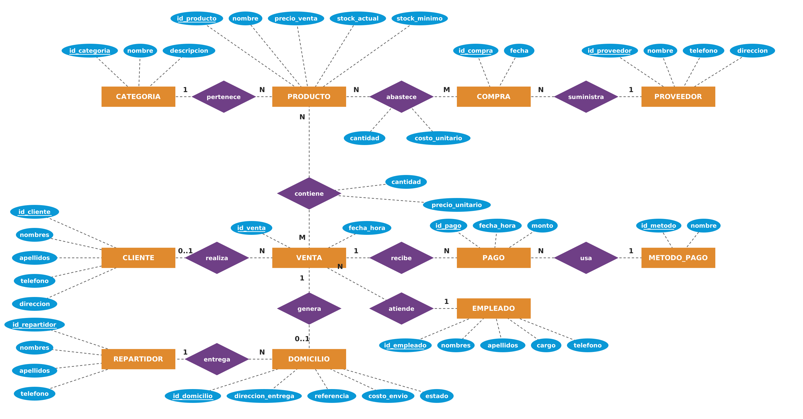
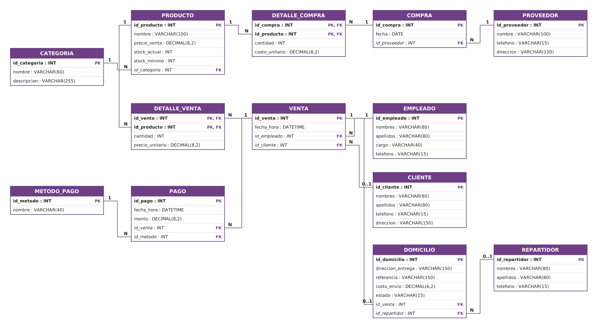

<div align="center">

# ☕ La Huequita del Sabor

### Diseño de una base de datos relacional para la gestión de una cafetería

**Proyecto académico · Base de datos · MySQL 8.0**


</div>

---

## 📌 Presentación del proyecto

**La Huequita del Sabor** es una cafetería familiar que ofrece bebidas, snacks, productos de panadería, postres y helados. Este proyecto desarrolla el diseño de una base de datos relacional para representar y organizar la información de sus actividades: productos, inventario, proveedores, compras, empleados, clientes, ventas, pagos y pedidos a domicilio.

La propuesta parte del análisis de las necesidades del negocio y presenta los modelos de datos, la estructura de las tablas mediante SQL y ejemplos de consultas formuladas en álgebra relacional y traducidas a SQL.

## 🎯 Objetivo general

Diseñar e implementar conceptualmente una base de datos relacional, mediante los modelos entidad-relación y relacional y el lenguaje SQL, para gestionar los productos, el stock, las ventas diarias, los pagos y los pedidos a domicilio de la cafetería **La Huequita del Sabor**.

## 🧩 1. Modelos de la base de datos

### 1.1. Modelo entidad-relación (E-R)

El modelo entidad-relación representa las entidades principales del negocio, sus atributos y las relaciones que existen entre ellas. Se utiliza para comprender cómo se organiza la información antes de construir las tablas.

<div align="center">



*Figura 1. Diagrama entidad-relación de La Huequita del Sabor.*

</div>

[Ver o editar el diagrama E-R](diagrams/huequita_er.drawio)

### 1.2. Modelo relacional

El modelo relacional muestra cómo se transforma el diseño conceptual en tablas, identificando las claves primarias (PK) y las claves foráneas (FK) que permiten relacionar la información.

<div align="center">



*Figura 2. Modelo relacional de La Huequita del Sabor.*

</div>

[Ver o editar el modelo relacional](diagrams/huequita_relacional.drawio)

#### Diagrama de tablas

[](diagrams/huequita_relacional_tablas.png)

### 1.3. Tablas que conforman el modelo

La base de datos está organizada en **13 tablas**:

| N.º | Tabla | Descripción |
|:---:|---|---|
| 01 | `categoria` | Clasificación de los productos |
| 02 | `producto` | Nombre, precio y existencias de cada producto |
| 03 | `proveedor` | Información de los proveedores |
| 04 | `compra` | Registro de compras realizadas |
| 05 | `detalle_compra` | Productos y cantidades de cada compra |
| 06 | `empleado` | Datos de los empleados |
| 07 | `cliente` | Información de los clientes |
| 08 | `venta` | Registro de las ventas |
| 09 | `detalle_venta` | Productos, cantidades y precios de cada venta |
| 10 | `metodo_pago` | Métodos de pago disponibles |
| 11 | `pago` | Pagos asociados a las ventas |
| 12 | `repartidor` | Datos de los repartidores |
| 13 | `domicilio` | Dirección, costo, estado y repartidor del pedido |

El esquema relacional en formato de texto también está disponible en [`docs/modelo_relacional.txt`](docs/modelo_relacional.txt).

## 💻 2. Código SQL y estructura de las tablas

El proyecto contiene los scripts SQL que representan la estructura de la base de datos y los registros de ejemplo. Los archivos están organizados de la siguiente manera:

| Archivo | Contenido |
|---|---|
| [`01_ddl.sql`](sql/01_ddl.sql) | Sentencias DDL para crear la base de datos y sus 13 tablas, con claves y restricciones |
| [`02_dml.sql`](sql/02_dml.sql) | Sentencias DML con datos de ejemplo para las tablas |
| [`03_consultas.sql`](sql/03_consultas.sql) | Cinco ejemplos de álgebra relacional y su traducción a SQL |
| [`04_verificacion.sql`](sql/04_verificacion.sql) | Consultas `SELECT` para visualizar los registros de las tablas |

### Organización de las relaciones

- Las relaciones de uno a muchos (1:N) se representan mediante claves foráneas.
- Las relaciones de muchos a muchos (M:N) se resuelven con `detalle_venta` y `detalle_compra`.
- Las claves primarias identifican de forma única cada registro.
- Las restricciones `NOT NULL`, `UNIQUE` y `CHECK` ayudan a mantener la integridad de los datos.

## 🔎 3. Ejemplos de álgebra relacional y SQL

Se presentan cinco consultas que responden a necesidades de información de la cafetería. Cada ejemplo incluye su planteamiento en álgebra relacional y su equivalente en SQL.

### Ejemplo 1. Productos con stock bajo

**Objetivo:** identificar los productos cuyo stock actual es menor o igual al stock mínimo.

**Álgebra relacional:**

\[
\pi_{nombre,\ stock\_actual,\ stock\_minimo}
\left(\sigma_{stock\_actual \leq stock\_minimo}(PRODUCTO)\right)
\]

**SQL:**

```sql
SELECT nombre, stock_actual, stock_minimo
FROM producto
WHERE stock_actual <= stock_minimo;
```

### Ejemplo 2. Pedidos a domicilio pendientes o en camino

**Objetivo:** consultar los pedidos que todavía no han sido entregados, mostrando cliente, dirección, estado y repartidor asignado.

**Álgebra relacional:**

```text
π id_domicilio, fecha_hora, nombres, apellidos,
  direccion_entrega, estado, repartidor.nombres
(
  σ estado = 'Pendiente' ∨ estado = 'En camino'
  (
    DOMICILIO ⋈ VENTA ⋈ CLIENTE ⋈(izq.) REPARTIDOR
  )
)
```

**SQL:**

```sql
SELECT d.id_domicilio, v.fecha_hora,
       CONCAT(c.nombres, ' ', c.apellidos) AS cliente,
       d.direccion_entrega, d.estado,
       r.nombres AS repartidor
FROM domicilio d
JOIN venta v ON v.id_venta = d.id_venta
JOIN cliente c ON c.id_cliente = v.id_cliente
LEFT JOIN repartidor r ON r.id_repartidor = d.id_repartidor
WHERE d.estado IN ('Pendiente', 'En camino');
```

### Ejemplo 3. Productos que nunca se han vendido

**Objetivo:** encontrar los productos que no aparecen en ningún detalle de venta.

**Álgebra relacional:**

\[
\pi_{nombre}
\left(
PRODUCTO \bowtie
\left(
\pi_{id\_producto}(PRODUCTO)
-
\pi_{id\_producto}(DETALLE\_VENTA)
\right)
\right)
\]

**SQL:**

```sql
SELECT p.nombre
FROM producto p
WHERE p.id_producto NOT IN (
    SELECT dv.id_producto
    FROM detalle_venta dv
);
```

### Ejemplo 4. Ingresos por categoría

**Objetivo:** conocer las unidades vendidas y los ingresos por categoría, mostrando las categorías que superan los $3,00.

**Álgebra relacional:**

```text
σ total_ingresos > 3
(
  γ categoria.nombre;
    SUM(cantidad) → unidades,
    SUM(cantidad × precio_unitario) → total_ingresos
  (DETALLE_VENTA ⋈ PRODUCTO ⋈ CATEGORIA)
)
```

**SQL:**

```sql
SELECT c.nombre AS categoria,
       SUM(dv.cantidad) AS unidades,
       SUM(dv.cantidad * dv.precio_unitario) AS total_ingresos
FROM detalle_venta dv
JOIN producto p ON p.id_producto = dv.id_producto
JOIN categoria c ON c.id_categoria = p.id_categoria
GROUP BY c.nombre
HAVING SUM(dv.cantidad * dv.precio_unitario) > 3
ORDER BY total_ingresos DESC;
```

### Ejemplo 5. Clientes que han comprado todas las bebidas

**Objetivo:** identificar a los clientes que han adquirido todos los productos de la categoría Bebidas.

**Álgebra relacional:**

```text
COMPRAS ← π id_cliente, id_producto
          (σ id_cliente ≠ NULL (VENTA ⋈ DETALLE_VENTA))

BEBIDAS ← π id_producto
          (σ CATEGORIA.nombre = 'Bebidas'
          (PRODUCTO ⋈ CATEGORIA))

RESULTADO ← π nombres, apellidos
             (CLIENTE ⋈ (COMPRAS ÷ BEBIDAS))
```

**SQL:**

```sql
SELECT cl.nombres, cl.apellidos
FROM cliente cl
WHERE NOT EXISTS (
    SELECT p.id_producto
    FROM producto p
    JOIN categoria c ON c.id_categoria = p.id_categoria
    WHERE c.nombre = 'Bebidas'
      AND NOT EXISTS (
          SELECT 1
          FROM venta v
          JOIN detalle_venta dv ON dv.id_venta = v.id_venta
          WHERE v.id_cliente = cl.id_cliente
            AND dv.id_producto = p.id_producto
      )
);
```

> Los cinco ejemplos también se encuentran organizados en el archivo [`sql/03_consultas.sql`](sql/03_consultas.sql).

## 🛠️ Tecnologías y herramientas

- **MySQL 8.0:** sistema gestor de base de datos.
- **SQL:** definición, manipulación y consulta de datos.
- **Álgebra relacional:** representación formal de las consultas.
- **diagrams.net:** elaboración de los diagramas entidad-relación y relacional.

## 📄 Documentación del proyecto

El informe académico completo contiene el contexto del problema, objetivos, modelos, estructura SQL, datos de ejemplo, consultas, conclusiones y bibliografía.

- [Informe de evaluación – Word](docs/Evaluacion_U1_La_Huequita_del_Sabor.docx)
- [Modelo relacional en texto](docs/modelo_relacional.txt)

## 🎓 Datos académicos

| Campo | Información |
|---|---|
| Institución | Universidad Nacional de Loja |
| Facultad / carrera | FEIRNNR – Carrera de Computación |
| Asignatura | Base de datos |
| Ciclo | 3A |
| Unidad | 1 |
| Docente | Edwin René Guamán Quinche |
| Estudiante | Gabriel Suárez |

---

<div align="center">

**☕ LA HUEQUITA DEL SABOR**

*Una propuesta de organización y gestión de información mediante bases de datos relacionales.*

</div>
