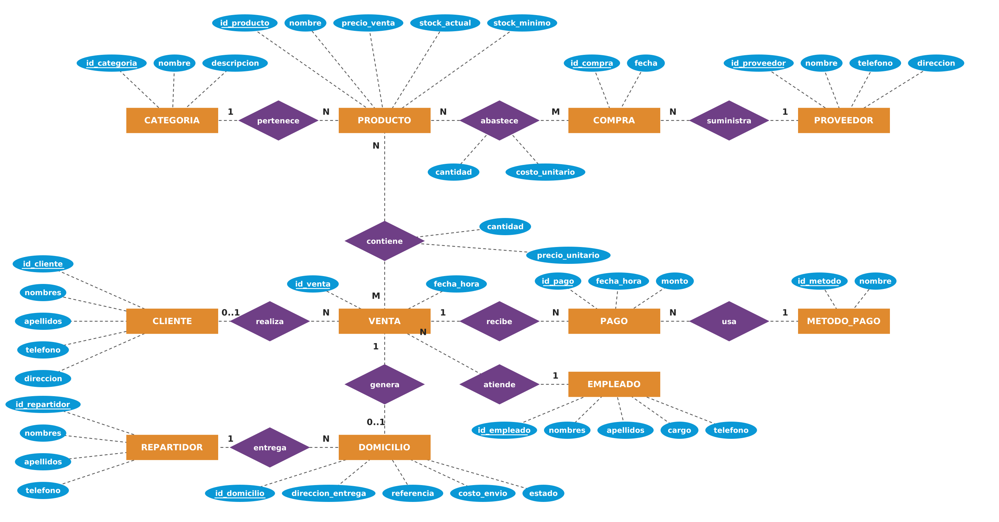
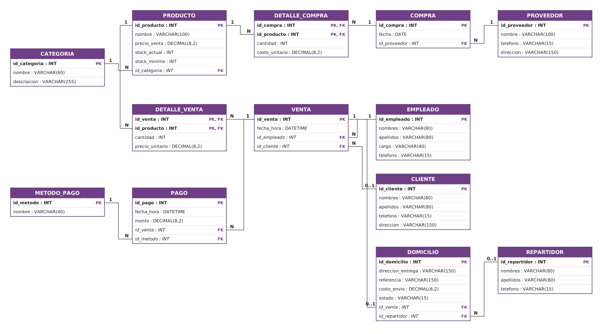

<div align="center">

# ☕ La Huequita del Sabor

### Sistema de gestión de productos, inventario, ventas y pedidos a domicilio

**Proyecto académico de diseño e implementación de una base de datos relacional**

<br>


</div>

---

## 📌 Sobre el proyecto

**La Huequita del Sabor** es una cafetería familiar que ofrece bebidas, snacks, productos de panadería, postres y helados. Este proyecto propone una base de datos relacional para organizar y administrar la información principal del negocio.

La solución permite estructurar el registro de productos, categorías, proveedores, compras, existencias, empleados, clientes, ventas, pagos y pedidos a domicilio. También incorpora consultas SQL para obtener información útil para la toma de decisiones.

> **Objetivo:** diseñar e implementar una base de datos relacional en MySQL 8.0 que facilite la administración de la cafetería y mantenga la información organizada, íntegra y disponible para consultas.

## ✨ ¿Qué incluye?

| Módulo | Descripción |
|---|---|
| 🧁 Productos y categorías | Catálogo de productos, precios y clasificación |
| 📦 Inventario | Existencias actuales y niveles mínimos de stock |
| 🚚 Proveedores y compras | Registro de proveedores, compras y sus detalles |
| 🧾 Ventas | Registro de ventas y productos vendidos |
| 💳 Pagos | Pagos por efectivo, transferencia y tarjetas, entre otros |
| 🛵 Pedidos a domicilio | Dirección, costo de envío, estado y repartidor |
| 📊 Consultas SQL | Cinco consultas para analizar información del negocio |

## 🗂️ Estructura del repositorio

```text
huequita-del-sabor-bd/
│
├── README.md
├── .gitignore
│
├── sql/
│   ├── 01_ddl.sql
│   ├── 02_dml.sql
│   ├── 03_consultas.sql
│   └── 04_verificacion.sql
│
├── diagrams/
│   ├── huequita_er.png
│   ├── huequita_er.drawio
│   ├── huequita_relacional.png
│   └── huequita_relacional.drawio
│
└── docs/
    ├── Evaluacion_U1_La_Huequita_del_Sabor.docx
    ├── modelo_relacional.txt
    └── guia-ejecucion.md
```

## 🧩 Diseño de la base de datos

El diseño está compuesto por **13 tablas**, organizadas para representar las operaciones principales de la cafetería. Se aplicó el modelo entidad-relación y su transformación al modelo relacional, considerando claves primarias, claves foráneas y relaciones entre entidades.

### Diagrama entidad-relación

Este modelo representa las entidades, sus atributos y las relaciones que existen entre ellas.

<div align="center">



</div>

### Modelo relacional

El modelo relacional muestra la estructura de las tablas y cómo se conectan mediante sus claves.

<div align="center">



</div>

Los archivos `.drawio` se pueden abrir y editar desde [diagrams.net](https://app.diagrams.net/).

### 📚 Tablas del sistema

| N.º | Tabla | Función |
|:---:|---|---|
| 01 | `categoria` | Clasificación de los productos |
| 02 | `producto` | Información, precios y stock |
| 03 | `proveedor` | Datos de proveedores |
| 04 | `compra` | Registro de compras |
| 05 | `detalle_compra` | Productos incluidos en cada compra |
| 06 | `empleado` | Información de los empleados |
| 07 | `cliente` | Información de los clientes |
| 08 | `venta` | Registro de ventas |
| 09 | `detalle_venta` | Productos incluidos en cada venta |
| 10 | `metodo_pago` | Métodos de pago disponibles |
| 11 | `pago` | Pagos realizados por venta |
| 12 | `repartidor` | Información de repartidores |
| 13 | `domicilio` | Pedidos y entregas a domicilio |

## ⚙️ Tecnologías utilizadas

- **MySQL 8.0:** sistema gestor de base de datos.
- **SQL (DDL):** creación de la base de datos y sus tablas.
- **SQL (DML):** inserción de registros de prueba.
- **Álgebra relacional:** formulación de consultas.
- **diagrams.net:** elaboración y edición de diagramas.

## 🚀 Instalación y ejecución

### Requisitos

- MySQL 8.0 o una versión compatible.
- MySQL Workbench (recomendado) o acceso a la terminal de MySQL.
- Git, si deseas clonar el repositorio.

### 1. Clonar el repositorio

```bash
git clone https://github.com/GabrielSuarezUNL/Proyecto_Base-de-datos.git
cd Proyecto_Base-de-datos
```

### 2. Crear las tablas

Ejecuta primero el archivo:

```text
sql/01_ddl.sql
```

Este archivo crea la base de datos `huequita_del_sabor` y las 13 tablas.

### 3. Insertar los datos de prueba

Ejecuta:

```text
sql/02_dml.sql
```

Se cargarán los registros de ejemplo para probar el funcionamiento de la base de datos.

### 4. Ejecutar las consultas

Ejecuta:

```text
sql/03_consultas.sql
```

Este archivo contiene las cinco consultas de análisis.

### 5. Verificar los registros

Finalmente, ejecuta:

```text
sql/04_verificacion.sql
```

Este script permite visualizar las tablas y comprobar los datos almacenados.

> **Importante:** ejecuta los archivos en el orden indicado. Puedes abrirlos desde MySQL Workbench mediante `File → Open SQL Script`.

## 🔎 Consultas de álgebra relacional y SQL

El proyecto desarrolla cinco consultas orientadas a resolver necesidades reales de la cafetería:

| N.º | Operación | Consulta |
|:---:|---|---|
| 01 | Selección y proyección | Productos con stock bajo |
| 02 | Reunión (JOIN) | Pedidos pendientes o en camino |
| 03 | Diferencia | Productos que nunca se han vendido |
| 04 | Agrupamiento y agregación | Ingresos por categoría |
| 05 | División | Clientes que han comprado todas las bebidas |

Todas las consultas están documentadas en [`sql/03_consultas.sql`](sql/03_consultas.sql), junto con su planteamiento en álgebra relacional.

## 🛡️ Integridad y organización de los datos

Para mantener la consistencia de la información se utilizan:

- `PRIMARY KEY` para identificar cada registro.
- `FOREIGN KEY` para relacionar las tablas.
- `UNIQUE` para evitar valores duplicados en campos definidos.
- `NOT NULL` para exigir datos obligatorios.
- `CHECK` para validar cantidades, precios, costos y estados.
- `DEFAULT` para establecer valores iniciales.

Las relaciones muchos a muchos se resuelven mediante las tablas intermedias `detalle_venta` y `detalle_compra`. El total de una venta se obtiene mediante el cálculo de sus detalles y, cuando corresponde, el costo de envío.

## 📄 Documentación

El informe académico completo se encuentra en la carpeta [`docs/`](docs/). Incluye el planteamiento del problema, objetivos, modelos de datos, estructura SQL, registros de prueba, consultas, conclusiones y bibliografía.

- [Abrir informe de evaluación (Word)](docs/Evaluacion_U1_La_Huequita_del_Sabor.docx)
- [Consultar modelo relacional en texto](docs/modelo_relacional.txt)
- [Leer guía de ejecución](docs/guia-ejecucion.md)

## 🎓 Información académica

| Campo | Información |
|---|---|
| Institución | Universidad Nacional de Loja |
| Facultad / carrera | FEIRNNR – Carrera de Computación |
| Asignatura | Base de datos |
| Ciclo | 3A |
| Unidad | 1 |
| Docente | Edwin René Guamán Quinche |
| Estudiante | Gabriel Suárez |

---

<div align="center">

**La Huequita del Sabor**  
*Organizando la información para mejorar la gestión de una cafetería.*

</div>
