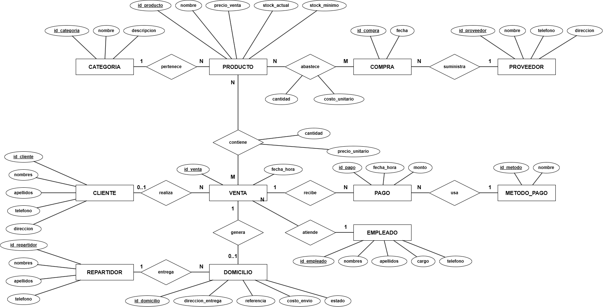
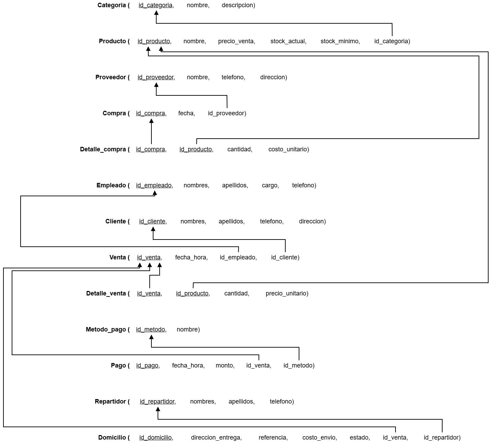

# Portafolio de Base de Datos

**Universidad Nacional de Loja · Carrera de Computación** 
Gabriel Suárez · Unidad 1

[Carátula](README.md) · [Modelos](#modelos-de-la-base-de-datos) · [Scripts y consultas](#scripts-y-consultas) · [Conclusiones](#conclusiones)

## Objetivo

Diseñar una base de datos relacional para controlar el inventario, las compras, las ventas, los pagos y los pedidos a domicilio de la cafetería **La Huequita del Sabor**.

## Unidad 1

El proyecto comprende los modelos de la base de datos, la implementación en MySQL y cinco consultas de álgebra relacional con su equivalente en SQL. [Ver la documentación completa de la Unidad 1](La_Huequita_del_Sabor/huequita-del-sabor-bd/README.md).

## Modelos de la base de datos

### Modelo entidad-relación

El diagrama muestra las entidades de la cafetería, sus atributos y las cardinalidades de sus relaciones.

[Archivo editable del modelo entidad-relación](La_Huequita_del_Sabor/huequita-del-sabor-bd/diagrams/huequita_er.drawio)

### Modelo relacional

El esquema presenta las 13 tablas, con las claves primarias subrayadas y flechas desde las claves foráneas hacia las claves que referencian.

[Archivo editable del modelo relacional](La_Huequita_del_Sabor/huequita-del-sabor-bd/diagrams/huequita_relacional.drawio) · [Esquema en texto](La_Huequita_del_Sabor/huequita-del-sabor-bd/docs/modelo_relacional.txt)

## Scripts y consultas

| Archivo | Contenido |
| --- | --- |
| [01_ddl.sql](La_Huequita_del_Sabor/huequita-del-sabor-bd/sql/01_ddl.sql) | Creación de las 13 tablas y sus restricciones |
| [02_dml.sql](La_Huequita_del_Sabor/huequita-del-sabor-bd/sql/02_dml.sql) | Carga de los datos de prueba |
| [03_consultas.sql](La_Huequita_del_Sabor/huequita-del-sabor-bd/sql/03_consultas.sql) | Stock bajo, domicilios abiertos, productos sin ventas, ingresos por categoría y clientes que compraron todas las bebidas |
| [04_verificacion.sql](La_Huequita_del_Sabor/huequita-del-sabor-bd/sql/04_verificacion.sql) | Consultas para revisar los registros de cada tabla |

## Conclusiones

El diseño usa tablas de detalle para representar los productos de cada compra y venta. Las claves foráneas conectan esos movimientos con el inventario y vinculan las ventas con sus pagos y domicilios. Las consultas permiten detectar faltantes de stock, seguir pedidos abiertos y calcular ingresos por categoría.

## Referencias

- [Manual de referencia de MySQL 8.0](https://dev.mysql.com/doc/refman/8.0/en/)
- [Calculadora de álgebra relacional RelaX](https://dbis-uibk.github.io/relax/)

[Volver a la carátula](README.md)
